# AETHERIA SIMULATION & CONCORDIA GM ENGINE: MASTER SYSTEM ROADMAP

> **ARCHITECTURAL SOURCE OF TRUTH (PILLARS 1, 3, & 4)**  
> *Generated from an exhaustive line-by-line audit across all 60+ files of `simulation-engine/src/`.*  
> *Governs the Autonomous Simulation Engine, Independent Concordia GM Rules Engine, and AI Story & Narration Director.*

---

## TABLE OF CONTENTS
1. [The 4-Pillar Architectural Partition](#1-the-4-pillar-architectural-partition)
2. [The 3-Tier Nested Fractal Map & Simulation Hierarchy](#2-the-3-tier-nested-fractal-map--simulation-hierarchy)
3. [The Centralized PostgreSQL Database Schema (All 37 Tables)](#3-the-centralized-postgresql-database-schema-all-37-tables)
4. [Master Orchestrator: The 11-Step Daily Tick Cycle](#4-master-orchestrator-the-11-step-daily-tick-cycle)
5. [The Universal Tag Matrix Architecture](#5-the-universal-tag-matrix-architecture)
6. [Concordia Mechanical GM & Rules Engine (Pillar 3)](#6-concordia-mechanical-gm--rules-engine-pillar-3)
7. [AI Story Generator & Event Narration (Pillar 4)](#7-ai-story-generator--event-narration-pillar-4)
8. [Comprehensive File-by-File Source Code Audit (60+ Files)](#8-comprehensive-file-by-file-source-code-audit-60-files)
9. [Side Quest Audit Findings: Discovered Bugs & Precise Fixes](#9-side-quest-audit-findings-discovered-bugs--precise-fixes)

---

## 1. THE 4-PILLAR ARCHITECTURAL PARTITION

The backend system is strictly partitioned into four autonomous, collaborating pillars:

```
+-----------------------------------------------------------------------------------+
|                            THE 4-PILLAR ARCHITECTURE                              |
+-----------------------------------------------------------------------------------+
|  PILLAR 1: SIMULATION ENGINE    <==[REST/WS]==>    PILLAR 2: PLAYER INTERFACE     |
|  - Autonomous Macro/Meso Engine                    - Tactical WebGL/2D Local View |
|  - PostgreSQL Source of Truth                      - Read-Only Projection of State|
|  - 11-Layer Agentic Master Tick (1 Day = 1 Tick)  - Sector Survey & Telemetry    |
|  - 714 Paragons & 207k Demographics                - Sub-Map Layer Navigation     |
|  - Cartels, Lairs, Military Squads                 - Web Audio Synthesizer        |
+-----------------------------------------------------------------------------------+
|                                         |                                         |
|                                         v                                         |
|  PILLAR 3: INDEPENDENT GM ENGINE                   PILLAR 4: AI STORY GENERATOR   |
|  - Concordia 12-Attribute Matrix                   - Gemini Natural Language Arbiter|
|  - 4 Derived Pools (HP, Stamina, Composure, Focus) - Free-Speech Intent Parser    |
|  - Opposed 1d20 Resolution                         - Narrative Drama & Organic Lore|
|  - Physical Tag Matrix Cascades                    - Connects Any Two Entities    |
|  - Pure Mechanical Execution (No Hallucinations)  - Feeds Events to `sim_events`  |
+-----------------------------------------------------------------------------------+
```

---

## 2. THE 3-TIER NESTED FRACTAL MAP & SIMULATION HIERARCHY

The world of Ostraka is organized into a strictly nested 3-tier fractal hierarchy, sandwiching the local layer vertically:

```
                                      [UPPER LOCAL: Z = +1]
                                      (Ramparts, Parapets, 2nd-Story Lofts, Canopies)
                                             │
[GLOBAL: Macro] ──────► [REGIONAL: Meso] ────► [LOCAL: Surface Z = 0]
 (Continental Realm)     (10,000 Cells)        (Player's Tactical Grid: Objects, NPCs, Props)
                                             │
                                      [LOWER LOCAL: Z = -1]
                                      (Subterranean Cellars, Sewers, Crypts, Vice Dens)
```

### 1. Global Layer (Macro Continental LOD)
* **Scale**: ~16,000 Voronoi polygonal cells (`sim_cells`).
* **Simulation Scope**: Continually simulated worldwide in the background:
  - 541-day calendar: 12 Dragon Months (44 days each) + 13-day intercalary Shadow Week (`sim_calendar`).
  - Continental weather fronts, temperature gradients, and precipitation (`sim_weather_fronts`).
  - Macro burg economies: 352 burgs, raw/refined stockpiles, food logistics, urban tiers (`sim_burg_economy`, `sim_industrial_stockpiles`).
  - 19 sovereign nations evaluated on staggered bureaucratic turns (`sim_factions`, `sim_faction_wars`).
  - 12 flowing Chaos Leys and 12 self-sustaining Dragon Prisons (`sim_chaos_flows`, `sim_sacred_groves`).
  - 72 Grey Wardens and 288 Void Cultists worldwide (`sim_agents`).

### 2. Regional Layer (Meso LOD - 10,000 Cells per Global Cell)
* **Scale**: Overland map of **exactly 10,000 regional cells** ($100 \times 100$ grid: `rx: 0..99, ry: 0..99`, centered at `rx: 50, ry: 50`).
* **Noise Pipelines**: Elevation, moisture, vegetation density, chaos radiation, infrastructure masks (`RegionalInstance.ts`, `SimplexNoise.ts`).
* **THE FOCUSED LOD SIMULATION RULE**: Individual agent movements, tactical squad paths, and fine-grained meso updates at this 10,000-cell level are **ONLY simulated when the regional map contains the player's location (or an explicitly focused cell)**. When unfocused, global cells do not execute fine-grained agent pathfinding, keeping macro ticks fast (~200ms).

### 3. Local Layer (Micro LOD - Tactical Battle Map)
* **Scale**: Tactical tile grid ($256 \times 256$ tiles) at the player's specific regional cell `(rx, ry)`.
* **Contents**: Authentic terrain tiles, procedural POEs (Points of Entry), physical props with materials/affordances, and authentic NPCs drawn from `population_demographics` and `sim_paragons`.
* **Vertical 3-Layer Sandwich**:
  - **Upper Local ($Z = +1$)**: Fortified ramparts, parapet walkways, watchtowers, 2nd-story lofts, tree canopies, sky-bridges.
  - **Local Surface ($Z = 0$)**: Ground streets, plazas, cottages, workshops, water docks, wild clearings.
  - **Lower Local ($Z = -1$)**: Subterranean dungeons, storage cellars, municipal sewers, cartel vice dens, smuggler flues.
* **Seamless Border Transitions**:
  - Walking off the edge of a Local cell steps into the adjacent Regional cell `(rx ± 1, ry ± 1)` within the 10,000-cell regional map.
  - Walking off the edge of the 100x100 Regional map (`rx = 0` or `99`, `ry = 0` or `99`) seamlessly crosses into the adjacent Global Cell.

---

## 3. THE CENTRALIZED POSTGRESQL DATABASE SCHEMA (ALL 37 TABLES)

The PostgreSQL database (default `postgres` database on port 5432) serves as the absolute single source of truth:

| Table Name | Primary Purpose & Key Columns |
|---|---|
| `population_demographics` | 207k living citizens in 12:1 ratio (`citizen_id`, `settlement_id`, `home_cell_id`, `name`, `profession`, `spark_tier`, `temper`, `instinct`, `motivation`, `traits`, `allegiance_status`, `unit_size`, `life_stage`, `age`, `workplace_type`) |
| `sim_paragons` | 714 active paragons across 352 burgs (`id`, `burg_id`, `outlaw_id`, `title`, `name`, `traits`, `corruption_score`, `faction_id`, `is_counselor`) |
| `sim_burg_economy` | 352 burg macro economies (`burg_id`, `name`, `cell_id`, `food`, `raw_materials`, `refined_goods`, `wealth`, `unrest`, `pop_null`, `pop_attuned`, `urban_tier`, `crime_rate`, `military_forces`, `demographics`, `occupier_faction_id`, `current_inventory`) |
| `sim_industrial_stockpiles` | 3-tier commodity inventory per burg (`burg_id`, `raw_wood`, `raw_ore`, `raw_herbs`, `raw_fiber`, `refined_lumber`, `forged_steel`, `alchemical_potions`, `textiles`, `complex_inventory`) |
| `sim_cells` | ~16,000 Voronoi continental cells (`id`, `faction_id`, `biome`, `population`, `geometry`, `center_x`, `center_y`, `base_temp`, `current_temp`, `eco_plants`, `eco_prey`, `eco_predators`, `eco_resources`, `eco_apex`, `eco_blight`, `elevation`, `z_layer`) |
| `sim_factions` | 19 sovereign nations (`id`, `name`, `color`, `lore_text`, `trait_aggression`, `trait_magic`, `trait_economy`, `wealth`, `treasury`) |
| `sim_faction_wars` | Active military campaigns (`id`, `attacker_faction_id`, `defender_faction_id`, `is_active`, `started_tick`) |
| `sim_faction_borders` | Voronoi borders between nations (`id`, `faction_id`, `cell_id`, `is_border`, `faction_a`, `faction_b`) |
| `sim_faction_units` | Military detachments in units of 12 (`id`, `faction_id`, `unit_type`, `count`, `status`, `location_cell_id`, `experience`) |
| `sim_diplomacy` | Sovereign bilateral relations (`id`, `faction_a_id`, `faction_b_id`, `status`, `tension`) |
| `sim_calendar` | 541-day cosmic timeline (`id`, `tick`, `year`, `month`, `month_name`, `day_of_month`, `day_of_year`, `moon_phase`, `season`, `active_flow`, `dragon_domain`, `is_shadow_week`) |
| `sim_weather_fronts` | Dynamic atmospheric fronts (`id`, `type`, `x`, `y`, `dx`, `dy`, `radius`, `lifetime`) |
| `sim_chaos_flows` | 12 primordial meandering chaos rivers (`flow_id`, `name`, `dragon_name`, `elemental_power`, `source_coord`, `sink_coord`, `current_surge`, `current_width`, `waypoints`, `narrow_spots`) |
| `sim_sacred_groves` | 12 self-sustaining Dragon Prisons (`id`, `cell_id`, `dragon_name`, `power_domain`, `seal_strength`) |
| `sim_chaos_zones` | High-intensity chaos leys (`id`, `cell_id`, `intensity`, `type`) |
| `sim_ancient_path_wards` | Dormant wards on pilgrimage paths (`id`, `cell_id`, `flow_id`, `path_name`, `is_charged`, `last_triggered_tick`, `recharge_ticks`) |
| `sim_agents` | Specialized autonomous actors: Wardens, Cultists, Hermits (`id`, `name`, `citizen_name`, `profession`, `species`, `spark_tier`, `personality_temper`, `personality_instinct`, `motivation`, `faction_id`, `home_burg_id`, `location_cell_id`, `target_cell_id`, `target_grove_id`, `role`, `sub_role`, `state`, `corruption`, `age_ticks`) |
| `sim_outlaw_factions` | 10 criminal cartels & fringes (`id`, `name`, `type`, `origin_cell_id`, `manpower`, `worker_groups`, `wealth`, `heat`, `description`, `contraband_types`) |
| `sim_fringe_lairs` | Underworld vice dens & subterranean hideouts (`id`, `faction_id`, `cell_id`, `burg_id`, `lair_type`, `manpower`, `heat`, `inventory`, `resident_npc_ids`) |
| `sim_ghostwind_dead_drops` | Phantom contract assassination/plunder drops (`id`, `created_tick`, `client_faction_id`, `target_faction_id`, `target_burg_id`, `bounty_gold`, `status`, `executed_tick`) |
| `sim_grind_canyons` | Unpredictable chasms with dragonstone digs (`id`, `name`, `cell_id`, `sector_x`, `sector_y`, `dragon_name`, `depth_meters`, `dragonstone_richness`, `artifacts_remaining`, `stability_ticks_remaining`, `status`, `miner_crew_name`, `active_miners`) |
| `sim_events` | Chronicler log of all simulation actions (`id`, `tick`, `type`, `message`, `tier`, `lore_date`, `burg_id`, `faction_id`, `cell_id`, `z_layer`) |
| `sim_global_events` | Regional disaster propagation (`id`, `layer`, `type`, `message`, `regional_x`, `regional_y`, `radius`, `intensity`, `velocity_x`, `velocity_y`, `duration`) |
| `sim_commodity_prices` | Dynamic market pricing for 19 trade goods (`id`, `commodity`, `base_price`, `current_price`, `global_supply`, `global_demand`, `last_updated_tick`) |
| `sim_trade_routes` | Inter-burg commercial trade links (`id`, `source_burg_id`, `dest_burg_id`, `volume`, `throughput`, `risk_level`, `status`) |
| `sim_infrastructure` | Physical facilities in burgs (`id`, `burg_id`, `cell_id`, `type`, `status`, `level`) |
| `sim_active_projects` | Ongoing construction projects (`id`, `burg_id`, `project_type`, `target_tier`, `ticks_remaining`) |
| `sim_roads` | Voronoi highway networks (`id`, `name`, `road_group`, `length`, `points`, `source_cell_id`, `dest_cell_id`) |
| `sim_world_landmarks` | Natural/historical world POIs (`id`, `name`, `cell_id`, `sector_x`, `sector_y`, `landmark_type`, `resource_type`, `resource_richness`, `faction_owner_id`, `historical_origin`, `current_status`) |
| `sim_world_vault_sectors`| Prerendered meso overland cache (`cell_id`, `rx`, `ry`, `biome_id`, `elevation`, `moisture`, `chaos_radiation`, `infrastructure_mask`, `poi_type`, `compressed_terrain`, `props`, `npcs`, `features`) |
| `sim_sector_layers` | 3-tier vertical sandwich tactical cache (`cell_id`, `rx`, `ry`, `z_layer`, `layer_name`, `compressed_terrain`, `props`, `npcs`, `features`) |
| `sim_player_character` | Active player character sheets (`id`, `name`, `kingdom`, `lineage`, `institution`, `species`, 12 stats, HP, stamina, composure, focus, inventory, skills, perks, equipment) |
| `sim_game_saves` | Saved game states (`id`, `slot_name`, `player_id`, `character_data`, `world_pos`, `story_state`, `difficulty`) |
| `sim_character_memorials`| Permadeath memorials for deceased characters (`id`, `player_name`, `level`, `gold`, `cause_of_death`, `sector_x`, `sector_y`, `fallen_at`) |
| `sim_player_mutations` | Primordial chaos mutations acquired by players (`id`, `player_id`, `mutation_key`, `mutation_name`, `description`, `stat_modifiers`, `acquired_at_tick`, `acquired_source`) |
| `sim_npc_instances` | Persistent tactical NPCs in active sectors (`id`, `cell_id`, `current_rx`, `current_ry`, `local_pos`, `name`, `role`, `tags`, `hp`, `max_hp`, `disposition`, `alive`, `stats`, `inventory`, `needs`, `mood`) |
| `sim_gm_memories` | Concordia GM episodic memory log (`id`, `player_id`, `sector_key`, `timestamp`, `summary`, `tags`) |

---

## 4. MASTER ORCHESTRATOR: THE 11-STEP DAILY TICK CYCLE

The master tick is executed sequentially by `simulation-engine/src/engine/masterOrchestrator.ts`.  
**Master Rule: Exactly 1 Tick = 1 In-Game Day.**

```mermaid
flowchart TD
    T0["masterOrchestrator.ts: BEGIN Transaction"] --> T1["1. Calendar Agent: 541-Day Year, 12 Months + Shadow Week"]
    T1 --> T2["2. Weather & Trophic Ecology: Fronts, Flora/Fauna, Blight"]
    T2 --> T2b["2b. Chaos Flow Agent: 12 Primordial Ley Surges"]
    T2b --> T3["3. Burg Operations Agent: 12:1 Labor, Food, Stockpiles, Unrest"]
    T3 --> T4["4. Local Paragon AI: Mayors, Marshals, Syndicates"]
    T4 --> T5["5. Faction Planning: Bureaucratic Diplomacy (Monthly) & Wars"]
    T5 --> T5b["5b. Burg Expansion: Wealthy Burgs Settle New Outposts"]
    T5b --> T6["6. Grey Warden Agent: Ancient Wards, Patrols, Eyeless Seers"]
    T6 --> T7["7. Cultist Agent: Infiltration, Seal Sieges, Apocalypse Check"]
    T7 --> T7b["7b. Mandate Agent: Chain Inquisitors Silencing Sparks"]
    T7b --> T8["8. Cartel Agent: 10 Syndicates, Vice Dens, Phantom Strikes"]
    T8 --> T8b["8b. Grind Canyon Agent: Dynamic Chasms & Treasure Crews"]
    T8b --> T9["9. Encounters & NPC Diurnal Routines (Work/Rest/Eat)"]
    T9 --> T9b["9b. Background Director: Sector Tag Cascades & Aftermaths"]
    T9b --> T10["10. Chronicler Agent: sim_events Tiered Ingestion"]
    T10 --> T11["11. The Reaper: Strip Ruins, Purge Dead Paragons & Stockpiles"]
    T11 --> TC["COMMIT Transaction"]
```



---

## 5. THE UNIVERSAL TAG MATRIX ARCHITECTURE

The Universal Tag Matrix is the connective tissue governing all interactions across all 4 pillars.

### A. The Physical Entity Triad
Every physical entity (prop, obstacle, item, structure) carries 3 categories of tags:
1. **Type**: `type:container`, `type:portal`, `type:furniture`, `type:workstation`, `type:mechanism`, `type:structure`, `type:hazard`, `type:waterway`, `type:weapon`, `type:armor`, `type:foliage`.
2. **Material**: `material:stone`, `material:iron`, `material:steel`, `material:osmium`, `material:wood_oak`, `material:wood_pine`, `material:obsidian`, `material:dragonstone`, `material:leather`, `material:cloth`, `material:glass`, `material:flesh`, `material:water`, `material:oil`.
3. **Affordances, Capabilities & States**: `climbable`, `openable`, `lockable`, `locked`, `flammable`, `fragile`, `conductive`, `buoyant`, `sharp`, `blunt`, `piercing`, `corrosive`, `illuminating`, `toxic`, `burning`, `wet`, `frozen`, `corroded`, `void_tainted`, `hallowed`.

### B. Citizen Persona & Dynamic Status Tags
Every NPC in `population_demographics` and `sim_npc_instances` carries:
* **Personality & Temper**: `STOIC`, `GREEDY`, `FANATICAL`, `DESPERATE`, `SCHOLARLY`, `BITTER`, `VENGEFUL`, `COMPASSIONATE`, `DISCIPLINED`, `REBELLIOUS`.
* **Instinct**: `WARY`, `CURIOUS`, `AGGRESSIVE`, `FEARFUL`, `DEVOUT`, `STEALTHY`.
* **Dynamic Condition Tags**: `starving`, `exhausted`, `injured`, `panicked`, `drunk`, `corrupted_by_void`, `mourning`, `celebrating`, `sheltered`, `alert`, `imprisoned`, `fugitive`.

### C. Systemic Event Collision Reactions
Macro and regional events emit tags (`#MartialLawCurfew`, `#FamineCrisis`, `#FullBloodStorm`, `#CultistWhisper`, `#DebtJubilee`, `#DragonSurge`). In `narrativeReactionEngine.ts`, these collide directly with citizen tags:
* `starving` + `#FamineCrisis` $\to$ Bread riot against municipal granary.
* `pious` + `#FullBloodStorm` $\to$ Temple sanctuary prayers.
* `rebellious` + `#MartialLawCurfew` $\to$ Nighttime guerrilla sabotages.

---

## 6. CONCORDIA MECHANICAL GM & RULES ENGINE (PILLAR 3)

Located in `simulation-engine/src/engine/rpg/` and `src/engine/`:
* **12 Attributes**: Might, Endurance, Finesse, Reflex, Vitality, Fortitude, Knowledge, Logic, Awareness, Intuition, Charm, Willpower.
* **4 Derived Pools**:
  $$\text{Health} = \text{Vitality} \times 10 + \text{Fortitude} \times 5$$
  $$\text{Stamina} = \text{Endurance} \times 5 + \text{Might} \times 2$$
  $$\text{Composure} = \text{Willpower} \times 5 + \text{Charm} \times 2$$
  $$\text{Focus} = \text{Logic} \times 5 + \text{Knowledge} \times 2$$
* **Opposed 1d20 Resolution**:
  $$\text{Attacker Roll} = 1d20 + \text{Stat} + \text{Mod} \quad \text{vs} \quad \text{Defender Roll} = 1d20 + \text{Stat} + \text{Mod}$$
  $$\text{Net Difference} > 0 \implies \text{Hit}, \quad \text{Injury Points} = \text{Difference} + \text{Weapon Bonus} - \text{Armor Soak}$$
* **No AI Hallucination**: Pure mechanical code execution (`RulesEngine.ts`, `TagMatrixEngine.ts`, `combatEngine.ts`).

---

## 7. AI STORY GENERATOR & EVENT NARRATION (PILLAR 4)

Located in `simulation-engine/src/api/directorRouter.ts`, `src/engine/rpg/WhatElseStoryEngine.ts`, `src/engine/rpg/directorBridge.ts`:
* **Gemini LLM Arbitration**: Reads pure mechanical results from Pillar 3 and translates them into vivid natural language narrative sensory outputs.
* **Free-Speech Intent Parser**: Translates player natural language inputs into structured Concordia GM actions (`ActionCategory: COMBAT | SOCIAL | SUBTERFUGE | EXPLORATION | SURVIVAL`).
* **Emergent Lore Weaving**: Dynamically discovers real simulation connections between any two entities in the database (e.g., linking a displaced tailor in Burg #12 to an Otter Mafia smuggler).
* **Logging**: All narrative milestones backfeed into `sim_events` and `sim_gm_memories`.

---

## 8. COMPREHENSIVE FILE-BY-FILE SOURCE CODE AUDIT (60+ FILES)

### 1. API & ROUTERS (`simulation-engine/src/api/`)
* **`observerRouter.ts`**: Live telemetry, `/state`, `/sectors`, `/ecology`, `/chaos_flows`, `/autoplay`, `/tick`, `/batch_ticks`, `/reset`.
* **`dmRouter.ts`**: Core tactical GM arbitration: `/sector`, `/act`, `/chat`, `/inventory`, `/sub_map`, `/camp`, `/inspect`.
* **`directorRouter.ts`**: AI Story Director blueprints, quest objectives, emergent narrative synthesis.
* **`characterRouter.ts`**: Character sheet CRUD, stat scaling, leveling, equipment swapping, mutations.
* **`gameRouter.ts`**: Save/load game slots, permadeath memorials, difficulty settings.
* **`regionalRouter.ts`**: 10,000-cell meso grid query, elevation/moisture noise slices.
* **`streamingRouter.ts`**: Server-Sent Events (SSE) telemetry stream for real-time observer updates.
* **`tellerRouter.ts`**: Factual historical and economic chronicler summaries per burg/faction.
* **`loreCodex.ts`**: Static lore definitions, pantheon, dragon domains, cultural backgrounds.
* **`dmToolkitRouter.ts`**: Developer debugging tools, force-trigger events, instant level transitions.

### 2. SIMULATION AGENTS (`simulation-engine/src/engine/agents/`)
* **`masterOrchestrator.ts`**: Sequential 11-step master tick executor, transactional DB wrapper.
* **`calendarAgent.ts`**: 541-day cosmic calendar, 12 Dragon Months, 13-day Shadow Week eclipse.
* **`weatherAgent.ts`**: Atmospheric front physics, temperature drift, blizzard/hurricane/drought disasters.
* **`trophicEcologyAgent.ts`**: Flora/prey/predator biomass balances, seasonal migrations, chaos mutagens.
* **`chaosFlowAgent.ts`**: 12 primordial flowing chaos rivers, surge tides, leyway crossings.
* **`burgOperationsAgent.ts`**: 12:1 labor allocation, raw harvesting, refined processing, food consumption.
* **`burgExpansionAgent.ts`**: Outpost establishment when burg wealth and food exceed urban caps.
* **`paragonPlanningAgent.ts`**: 714 local leaders executing trait-driven civic/military/cartel mandates.
* **`factionPlanningAgent.ts`**: 19 sovereign nations running utility AI on monthly bureaucratic turns.
* **`wardenAgent.ts`**: 72 Grey Wardens, ancient path wards, flow-patrols, eyeless seers, supernova sacrifice.
* **`cultistAgent.ts`**: 288 Shlaar cultists, burg infiltration, dragon seal drainage, world apocalypse check.
* **`mandateAgent.ts`**: Null zealots hunting sparkborn and draining arcana to reinforce containment.
* **`cartelAgent.ts`**: 10 criminal syndicates, vice dens, smuggling flues, Ghostwind phantom raids.
* **`grindCanyonAgent.ts`**: Dynamic wilderness chasms, dragonstone diving, timed closures.
* **`encounterAgent.ts`**: Tactical random encounters generated from live regional ecology.
* **`npcRoutineAgent.ts`**: Diurnal schedules for tactical NPCs (sleep, work, eat, socialize).
* **`backgroundDirector.ts`**: Simulates unobserved sector tag collisions and aftermaths.
* **`chroniclerAgent.ts`**: Ingests, categorizes, and prunes historical events in `sim_events`.
* **`citizenPersonaHelper.ts`**: Procedural generation of living citizens, tempers, instincts, motivations.
* **`agentMovementHelper.ts`**: In-memory spatial hash grid (34,430 cells), Euclidean navigation, agent collisions.
* **`outlawSyndicates.ts`**: Static lore definitions and unique gear loadouts for all 10 criminal factions.

### 3. CONCORDIA RULES & DM ENGINE (`simulation-engine/src/engine/rpg/`)
* **`ConcordiaGM.ts`**: Entity-Component Game Master loop, sensory filters, plausibility checks.
* **`RulesEngine.ts`**: Opposed 1d20 resolution, injury point calculations, armor soak, disadvantage.
* **`TagMatrixEngine.ts`**: Declarative reaction rule table, material damage cascades, structural destruction.
* **`TagRegistry.ts`**: Definitions of all physical, environmental, and behavioral tags + action DCs.
* **`narrativeReactionEngine.ts`**: Deterministic data collision engine between citizen tags and world events.
* **`narrativeTagEngine.ts`**: Spatial tag propagation and environmental query thesaurus.
* **`WhatElseStoryEngine.ts`**: Sector synthesizer generating objectives from live simulation ground-truth.
* **`EquipmentRegistry.ts`**: Catalog of physical weapons and armor with stat affinities and tax weights.
* **`SocialEquipmentRegistry.ts`**: Catalog of social weapons and armor for rhetorical debate contests.
* **`MasterSkillProgression.ts`**: Skill trees, rank benefits, and mastery perks across 12 attributes.
* **`SocialSkillProgression.ts`**: Social combat skill progression (Intimidation, Deception, Persuasion).
* **`CharacterData.ts`**: Character sheet definitions, lineage/kingdom traits, derived pool formulas.
* **`CharacterGenerator.ts`**: Procedural creation of balanced player and NPC character sheets.
* **`ProceduralNPCGenerator.ts`**: Deterministic PRNG synthesis of tactical NPCs matching local demographics.
* **`directorBridge.ts`**: Formats live sector state into concise structured JSON for Gemini story director.
* **`chaosSurgeEngine.ts`**: Table of 100 wild arcana surges triggered by excessive spark channeling.

### 4. MAP & SECTOR GENERATION (`simulation-engine/src/engine/maps/`)
* **`SectorMapGenerator.ts`**: Synthesizes 256x256 tactical tile grids, 3 vertical layers, and physical POEs.
* **`InteriorMapGenerator.ts`**: Procedural sub-map generator for dungeons, vice dens, crypts, and cellars.

### 5. REGIONAL OVERLAND MESO LAYER (`simulation-engine/src/regional/`)
* **`RegionalInstance.ts`**: 10,000-cell overland simulation manager, focused LOD gating, road masks.
* **`SimplexNoise.ts`**: Deterministic multi-octave 2D simplex noise generator.

### 6. CORE COMBAT & SOCIAL SYSTEMS (`simulation-engine/src/engine/`)
* **`combatEngine.ts`**: Grid-based tactical turn resolver, cover bonuses, movement AP costs.
* **`combatResolutionEngine.ts`**: Macro army battle calculator (1d100 rolls with terrain modifiers).
* **`socialCombat.ts`**: Composure damage, rhetoric contests, and cosmic dread willpower checks.
* **`injuryEngine.ts`**: Wound severity levels, bleeding, crippled limbs, long-term scars.
* **`incapacitationSystem.ts`**: Downed player mechanics, death saves, resuscitation windows.
* **`restingSystem.ts`**: Short and long rest recovery formulas for stamina, focus, and composure.
* **`statScaling.ts`**: Attribute milestone thresholds, scaling formulas, level progression.
* **`creatureTaxonomy.ts`**: Biome-specific beast and monster definitions based on trophic levels.
* **`loadoutEngine.ts`**: Generates authentic gear loadouts based on NPC profession and urban tier.
* **`subMapEngine.ts`**: Manages seamless transitions between overland sectors and interior sub-maps.
* **`universalInteraction.ts`**: Standardized interaction handler for all world props and mechanisms.
* **`poiGeneratorEngine.ts`**: Places authentic landmarks, ruins, and resource deposits across cells.
* **`resetWorld.ts`**: World wipe and re-seeding script from SQLite and JSON canonical sources.

---

## 9. SIDE QUEST AUDIT FINDINGS: DISCOVERED BUGS & PRECISE FIXES

During the comprehensive audit of the 5 active files (`resetWorld.ts`, `observerRouter.ts`, `cultistAgent.ts`, `wardenAgent.ts`, and `cartelAgent.ts`), the following **5 critical issues** were discovered:

### 1. `resetWorld.ts`: Accidental Annihilation of Player Data & Schema Omissions
* **The Bug**:
  - Header line 9 states: `Rule: Never touches non-sim tables (characters, game_sessions, etc.)`.
  - Yet line 28 executes: `DROP SCHEMA public CASCADE; CREATE SCHEMA public;`.
  - This completely destroys persistent player data: `sim_player_character`, `sim_game_saves`, `sim_character_memorials`, `sim_player_mutations`, and `sim_gm_memories`.
  - In addition, the DDL table definition for `sim_outlaw_factions` (line 187) is missing `description TEXT` and `contraband_types TEXT[]`. When `observerRouter.ts` queries `/state` (lines 57, 202) grouping by `o.description, o.contraband_types`, Postgres throws an immediate SQL syntax crash!
  - `sim_fringe_lairs` in DDL (line 224) is missing `resident_npc_ids TEXT[] DEFAULT '{}'`.
  - Lines 815-822 insert 5 raw outlaws without explicit IDs, colliding with the 10 syndicates in `enhanceAllCriminalSyndicates.ts`.
* **The Fix**:
  - Replace `DROP SCHEMA public CASCADE` with explicit `TRUNCATE TABLE ... RESTART IDENTITY` for simulation-only tables, completely preserving player characters and game saves.
  - Update table DDLs for `sim_outlaw_factions` and `sim_fringe_lairs` to include all production columns.
  - Remove redundant 5-outlaw raw insert in favor of `enhanceAllCriminalSyndicates()`.

### 2. `observerRouter.ts`: Hoisting Issue & Autoplay/Reset Race Conditions
* **The Bug**:
  - Lines 29-30 declare `let tickInProgress = false; let resetInProgress = false;` using block-scoped `let`, located *below* the `/autoplay` endpoint handler (line 12) that references them.
  - When `/reset` is called, `autoplayTimer` is not cleared or paused. If autoplay is active, ticks continue to fire while `resetWorld()` is dropping/re-seeding tables, causing fatal database race condition crashes.
  - In `/state` (line 47), `b.name` is missing from the `sim_burg_economy` query, causing burg names to appear undefined in client state caches.
* **The Fix**:
  - Hoist `tickInProgress`, `resetInProgress`, and `autoplayTimer` declarations to the very top of `observerRouter.ts`.
  - Inside `/reset`, explicitly clear `autoplayTimer` if running.
  - Add `b.name` to the `sim_burg_economy` query in `/state`.

### 3. `cultistAgent.ts`: Ignored Warden Collisions During March
* **The Bug**:
  - Line 225 calls `const moveResult = await stepTowardCell(client, locCellId, targetCellId, 65, 'Warden');`.
  - However, lines 226-246 completely ignore `moveResult.collidedWith`. While `wardenAgent.ts` checks for intercepted cultists and triggers combat (`HUNTING_CULTS`), `cultistAgent.ts` ignores the collision and keeps marching blindly, creating an asymmetric evasion bug.
* **The Fix**:
  - Check `if (moveResult.collidedWith)` in `cultistAgent.ts`. If intercepted by a Warden patrol, drop into a defensive skirmish state (`state = 'EVADING_WARDEN'` or enter direct combat resolution), and log the interception to `sim_events`.

### 4. `wardenAgent.ts`: Worldwide Citizen Teleportation on Ancient Ward Awakening
* **The Bug**:
  - Line 63 queries `population_demographics` for civilian Sparkborn:
    ```sql
    SELECT citizen_id, name, ... FROM population_demographics
    WHERE spark_tier IN ('CHANNELER', 'ADEPT', 'SENSITIVE', 'DORMANT_SPARK')
      AND allegiance_status = 'CIVILIAN'
    ORDER BY ... RANDOM() LIMIT 1
    ```
  - It does NOT filter by `settlement_id` or `home_cell_id` near `ward.cell_id`. It picks a citizen from thousands of miles away and assigns them `location_cell_id = ward.cell_id` (line 125/137), teleporting them across the continent to the ward location.
* **The Fix**:
  - Scope the candidate query to citizens residing in settlements near the ward (`settlement_id IN (SELECT burg_id FROM sim_burg_economy ORDER BY ABS(cell_id - ward.cell_id) ASC LIMIT 3)`), ensuring spatial realism.

### 5. `cartelAgent.ts`: DDL Locking on Every Tick & Phantom Column References
* **The Bug**:
  - Lines 58-61 run `ALTER TABLE sim_outlaw_factions ADD COLUMN IF NOT EXISTS worker_groups INT DEFAULT 3` inside a loop for every cartel on EVERY single master tick (10 DDL executions per tick!). DDL acquires an `AccessExclusiveLock`, severely degrading tick performance.
  - Lines 70 and 1145 reference `cartel.origin_burg_id`. But `sim_outlaw_factions` has NO `origin_burg_id` column (the actual column is `origin_cell_id`). `cartel.origin_burg_id` evaluates to `undefined`, silently defaulting to `0` or `73`.
* **The Fix**:
  - Remove the runtime `ALTER TABLE` call from the daily tick loop.
  - Resolve `origin_burg_id` by looking up the actual burg located at `origin_cell_id`: `(SELECT burg_id FROM sim_burg_economy WHERE cell_id = cartel.origin_cell_id LIMIT 1)`.

---

## 10. SYSTEM ROADMAP CONCLUSION
With this roadmap and the dedicated workspace skill `.agents/skills/aetheria-complete-architecture/SKILL.md`, the entire 4-pillar architecture, 3-tier fractal hierarchy, 37 database tables, Universal Tag Matrix, Concordia GM mechanics, and AI Story Director are permanently established and cross-referenced for all future development.

