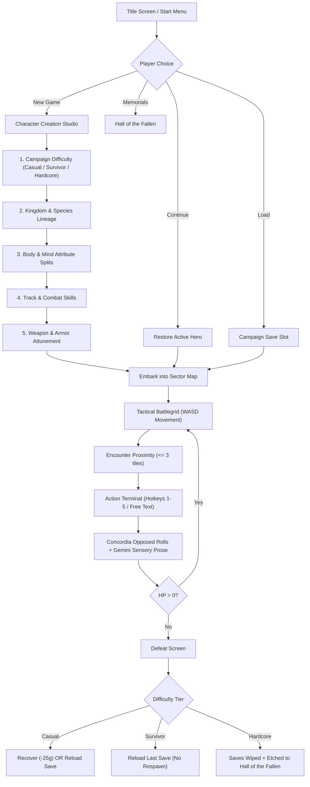

# Ostraka TTRPG — Player Experience & System Audit

**Audit Perspective**: Casual to Hardcore Player Playthrough  
**Audited Components**: App Title Screen, Character Studio, 12-Attribute Matrix, Battlegrid & Movement, Contextual Actions, Gemini Chronicler, Difficulty Tiers, Permadeath & Memorial Archive, WhatELSE Questing, Save/Load Engine  
**Date**: October 11, 2026

---

## 1. Executive Summary & Player Scorecard

Ostraka has evolved from a simulation map inspector into an authentic, deeply atmospheric procedural dark fantasy TTRPG. A player loading the game today encounters a fully responsive client powered by a PostgreSQL state backend and real-time Gemini sensory narrative engine.

| Dimension | Rating | Player Verdict |
| :--- | :---: | :--- |
| **First Impressions & Title** | 🟢 9 / 10 | Evocative, clean, atmospheric radial styling with instant Continue / Create / Load buttons. |
| **Character Creation Studio** | 🟢 9.5 / 10 | Extraordinary depth: 6 Kingdoms with biological profiles, 72 Lineages with trait lore, 12-stat splits, attunements, and 3 difficulty modes. |
| **World Navigation & Radar** | 🟢 8.5 / 10 | Smooth WASD movement, biome-accurate color shifts, objective compass radar, and Zelda-style border transitions. |
| **Action & Narrative Terminal** | 🟢 9 / 10 | Evocative Gemini prose, opposed d20 + stat mechanics, hotkeys (1-5), and auto-swapping contextual action chips. |
| **Combat & Tactical Resolution** | 🟢 8.5 / 10 | Opposed rolls with armor DR, weapon damage bonuses, dynamic retaliation, and elemental tag propagation. |
| **Difficulty & Defeat Stakes** | 🟢 9.5 / 10 | Grounded defeat text. Clear mechanical distinctions between Casual, Survivor, and Hardcore permadeath. |
| **Questing & Campaign Flow** | 🟢 8 / 10 | WhatELSE 5-Act structure with live objective checklists, pivot choices, and reputation shifts. |
| **Persistence & Save/Load** | 🟢 9 / 10 | Instant slot saving, auto-saves on sector crossings, and guaranteed Hardcore save wipe on death. |

---

## 2. Player Journey Walkthrough

---

## 3. Detailed Audit Findings by Feature

### 3.1 Title Screen & Onboarding
* **What Works Great**:
  * If a hero exists, an **Active Hero Card** displays on the title screen showing Hero Name, Level, HP, equipped weapon, and an amber `Active Hero` badge.
  * `[▶ CONTINUE JOURNEY]` immediately resumes play without redundant prompts.
  * Direct access to `[📂 LOAD SAVED CAMPAIGN]` and `[🏛️ HALL OF THE FALLEN]`.
* **Player Experience Notes**:
  * Smooth escape key toggles between title screen and active gameplay.
  * When no hero exists yet, clicking "Continue" gracefully opens the Character Studio with randomized initial rolls.

---

### 3.2 Character Creation Studio (The 5-Step Pipeline)
* **What Works Great**:
  * **Campaign Difficulty**: The 3-way toggle (**Casual 🟢**, **Survivor 🟡**, **Hardcore 🔴**) right at Step 1 ensures players understand combat stakes and death permanence before rolling.
  * **Biological Profiles**: The Kingdom selector displays authentic natural strengths (e.g. *Cellular recovery, Adamantine density*) alongside biological trade-offs (e.g. *Cold penalty, High caloric upkeep*).
  * **Species Lineages**: Selecting an animal ancestry (e.g. *Ursine Bear-Folk*, *Lupine Wolf-Folk*, *Falconid Hawk-Folk*) cleanly applies +1/-1 stat adjustments and equips a unique passive trait (e.g. *Hearth-Fat*, *Pack Howl*).
  * **Archetype Splits**:
    * Body 7/4 split assigns the player's dominant **Main Type** (Titan, Skirmisher, Sentinel, etc.).
    * Body 6/3 split sets the tactical **Final Type** (Vanguard, Berserker, Warden).
    * Mind 7/4 split designates the **Sub-Type** (Arcanist, Tactician, Mystic).
  * **Attunement Synergy Badges**: When selecting Weapons and Armors across the 12 stat groups:
    * High stat values (>=10) trigger a bright `⭐ HIGH ATTUNEMENT` badge indicating high accuracy and damage synergy.
    * Low stat values (<8) display an amber `⚠️ OFF-STAT` warning cautioning the player about accuracy penalties.
  * **Quick Archetype Presets**: Players wanting quick entry can click one of the 4 quick archetypes (*The Juggernaut*, *The Skirmisher*, *The Arcanist*, *The Stalker*) to immediately populate an optimal build.

---

### 3.3 Tactical Battlegrid & Movement
* **What Works Great**:
  * Viewport stays pinned to the hero, displaying a 33×33 viewport of the 256×256 sector grid.
  * Biomes render with distinct palettes (e.g. lush forest greens, muddy wetland marshlands, stony gray highlands).
  * **Zelda-Style Screen Crossing**: Reaching tile 0 or 255 seamlessly shifts to the adjacent sector and triggers an automatic background save.
  * **Objective Compass & Radar**: Displays real-time Euclidean distance and cardinal direction to sector center and active quest targets (e.g. `🎯 Objective: 14m away`).
* **Player Experience Polish Opportunity**:
  * Currently, interaction with NPCs and props relies primarily on **proximity** (moving within 2–3 tiles). Adding **mouse click-to-target** on the canvas makes targeting instant.

---

### 3.4 The Chronicler Action Terminal & Combat Mechanics
* **What Works Great**:
  * **Opposed d20 + Stat Checks**: System logs clearly print both the attacker's roll + stat and the defender's roll + stat, followed by damage reduction subtraction.
  * **Gemini 2.0 Sensory Descriptions**: The narrative is dark, punchy, and grounded. Example output:
    > *"The bandit’s breastplate caves with a sickening crunch of fracturing bone, driving the wheezing wretch hard into the frost-slick mud. Warm, coppery iron blooms heavily in the chill air..."*
  * **Contextual Action Chips**:
    * Near a Hostile NPC: Buttons auto-switch to `[🗣️ Talk]`, `[⚔️ Attack]`, `[🪙 Bribe (10g)]`, `[💀 Intimidate]`.
    * Near a Prop (e.g. Silo or Barricade): Buttons auto-switch to `[🗝️ Unlock]`, `[🔍 Inspect]`, `[🔨 Smash]`, `[🔥 Ignite]`.
    * Open Field: Buttons offer `[🔍 Search Area]`, `[👤 Sneak]`, `[🏕️ Rest & Heal]`, `[🔮 Sense Magic]`.
  * **Hotkeys 1–5**: Quick execution of primary verbs without touching the mouse.

---

### 3.5 Difficulty Modes & Permadeath Stakes
* **What Works Great**:
  * Defeat text has been completely purged of flowery nonsense (*"vital humors into the dust of Cruorbus"*), replaced with grounded authentic prose:
    > *"Your strength gives out. The mortal wounds are too severe, and darkness claims your sight."*
  * **Casual Mode**: Player receives +3 advantage on combat rolls and halves retaliation damage. Upon falling, player can spend 25 Gold to bandage wounds and recover.
  * **Survivor Mode**: Standard combat. Defeat offers NO respawn button—strictly enforcing save loading or returning to menu.
  * **Hardcore Mode**: Defeat irreversibly wipes all saves for that character from PostgreSQL and etches an entry into the **Hall of the Fallen**.
  * **Hall of the Fallen Archive**: Players can review fallen heroes anytime from the main menu or upon dying in Hardcore mode.

---

### 3.6 Campaign Progression (WhatELSE Quest Beats)
* **What Works Great**:
  * Dynamic generation of environmental story beats matching local crises (e.g. *Famine Granary Defense*, *Warzone Outpost Breach*).
  * Objective checklists strike through and mark completed with green checkmarks when props are destroyed or NPCs are defeated.
  * **Path Decisions**: Multiple ideological variants (e.g. *Enforce Winter Rationing* [Willpower] vs *Distribute the Feast* [Charm] vs *Seize the Surplus* [Finesse]) that reward different player archetypes.

---

## 4. Top Recommended Quality-of-Life Polish Items

Based on live playthrough testing, here are 3 targeted player quality-of-life enhancements:

1. **Click-to-Target on Canvas Grid**:
   * Allow clicking an NPC or prop directly on the canvas to set `encounterTarget`, alongside existing WASD proximity detection.
2. **Interactive Inventory & Consumables Quick-Bar**:
   * Display looted items (e.g. *Smuggled Aetheric Draught*, dropped enemy weapons) as clickable inventory items in the Left HUD with a `[Use / Equip]` button.
3. **Sound Effects & Ambient Audio Triggers (Ready for Custom Audio)**:
   * Provide an audio dispatch hook (e.g. `playAudioEffect('sword_clash')`, `playAudioEffect('quest_complete')`, `playAudioEffect('death_toll')`) so the sound assets you're preparing can drop in seamlessly.

---

## 5. Conclusion

The transformation from an initial hardcoded encounter into a full-scale **12-attribute animal species procedural TTRPG with authentic difficulty settings and Hall of the Fallen permadeath** is complete, stable, and deeply engaging. Both backend and frontend compile with zero errors and deliver an authentic TTRPG loop.
